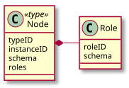

#+title: First post
#+date: 2021-10-02
#+hugo_base_dir: ../../..
#+hugo_section: posts
#+hugo_bundle: first
#+export_file_name: index
#+hugo_draft: false
#+audience: both
#+visibility: public
#+property: header-args+ :eval never-export
#+hugo_tags: test math hugo org
#+hugo_categories: Testing
#+hugo_publishdate: 2021-10-02
#+hugo_custom_front_matter: :math true

A meaningless post to test ox-hugo and Hugo.

#+hugo: more

In this test post I cover the following topics shows as a ToC.

#+toc: headlines 1

* Math
:PROPERTIES:
:CUSTOM_ID: math
:END:

$$\varphi = 1+\frac{1} {1+\frac{1} {1+\frac{1} {1+\cdots} } }$$

#+begin_example
\[ \alpha\beta\gamma \]
#+end_example

gives:

\[ \alpha\beta\gamma \]

* Section
:PROPERTIES:
:CUSTOM_ID: section
:END:

text text

** Subsection
:PROPERTIES:
:CUSTOM_ID: subsection
:END:

more text

* Plantuml
:PROPERTIES:
:CUSTOM_ID: plantuml
:END:

#+begin_src plantuml :file testnode.svg :exports both
@startuml
class "Node" as n << type >> {
        typeID
        instanceID
        schema
        roles
}
class Role {
        roleID
        schema
}
"n" *- Role
@enduml
#+end_src

#+RESULTS:

* Jsonnet
:PROPERTIES:
:CUSTOM_ID: jsonnet
:END:

#+begin_src jsonnet :exports both :wrap "src json"
{ a:42, b:"string", c:["array"] }
#+end_src

#+RESULTS:
#+begin_src json
{
   "a": 42,
   "b": "string",
   "c": [
      "array"
   ]
}
#+end_src

* C++
:PROPERTIES:
:CUSTOM_ID: cpp
:END:
#+begin_src cpp
  // Convert to C++ type
  T convert<T>(const Configuration& cfg);
  // Get object attribute as C++ type
  T get<T>(const Configuration& cfg, const std::string& name);
  x = "foo"
#+end_src
